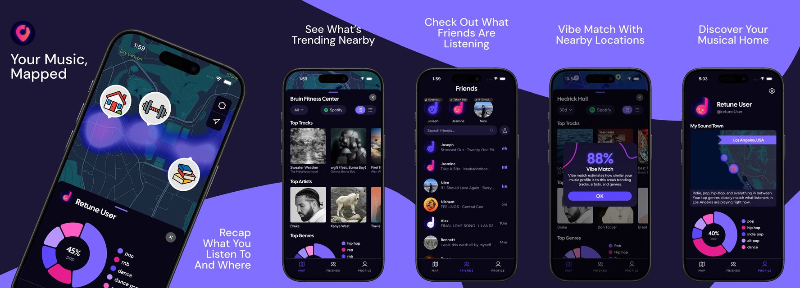

### Hi, i'm Mohsen!

I'm a junior studying computer science & engineering at ucla. last summer i built agent tools and llm pipelines at [agentai](https://www.agentai.app/), and i teach [combat robotics](https://catalog.registrar.ucla.edu/course/2024/engr1cr?siteYear=2024) at ucla year-round.

Building [retune](https://retuneapp.com/), a music app that turns cities into live heat maps of what people are listening to, alongside my team at [ucla devx](https://ucladevx.com).

[mohsensarrafan.com](https://mohsensarrafan.com)

Feel free to reach out!
